# JOCKY DFIR Gateway

> **Cross-platform Digital Forensics & Incident Response (DFIR) gateway for investigator-controlled endpoint triage, evidence inspection, integrity verification, and case-scoped analysis.**

JOCKY DFIR Gateway is a web-based forensic investigation platform designed to collect and present endpoint evidence from **Linux and Windows systems** through a centralized investigator dashboard.

The platform combines endpoint collection, case management, forensic artifact normalization, browser/application analysis, process and device inspection, filesystem investigation, live monitoring, cryptographic verification, and reporting in one workflow.

---

## Table of Contents

- [Overview](#overview)
- [Technical Approach](#technical-approach)
- [Architecture](#architecture)
- [Core Capabilities](#core-capabilities)
- [Supported Platforms](#supported-platforms)
- [Project Structure](#project-structure)
- [Installation](#installation)
- [Configuration](#configuration)
- [Running on Linux](#running-on-linux)
- [Running on Windows](#running-on-windows)
- [Running the Endpoint Agent](#running-the-endpoint-agent)
- [Investigator Workflow](#investigator-workflow)
- [Testing](#testing)
- [Evidence and Integrity Model](#evidence-and-integrity-model)
- [Screenshots](#screenshots)
- [Troubleshooting](#troubleshooting)
- [Security Notes](#security-notes)
- [Current Test Status](#current-test-status)

---

# Overview

Traditional endpoint investigation often requires investigators to switch between operating-system utilities, browser databases, filesystem tools, process viewers, log viewers, and separate evidence-hashing utilities.

JOCKY DFIR Gateway brings those operations into a single **case-scoped investigator workflow**.

### Primary goals

- Centralize Linux and Windows endpoint triage.
- Keep collected information associated with the selected forensic case.
- Present endpoint telemetry without relying on dummy/demo data.
- Preserve SHA-256 evidence fingerprints for integrity verification.
- Provide read-only filesystem and archive inspection.
- Provide browser, application, process, device, network, and system-log views.
- Support investigator-controlled live monitoring and snapshots.
- Provide a consistent web dashboard for investigation and reporting.

---

# Technical Approach

JOCKY follows a **centralized gateway + endpoint agent** architecture.

```text
                         ┌─────────────────────────┐
                         │   Investigator Browser  │
                         │       Web Dashboard     │
                         └────────────┬────────────┘
                                      │ HTTPS / HTTP
                                      ▼
                         ┌─────────────────────────┐
                         │    JOCKY DFIR Gateway   │
                         │                         │
                         │  Authentication / Case  │
                         │  REST APIs / Correlation│
                         │  Evidence / Reporting   │
                         └────────────┬────────────┘
                                      │
                         Case-scoped telemetry
                                      │
                    ┌─────────────────┴─────────────────┐
                    │                                   │
                    ▼                                   ▼
          ┌──────────────────┐               ┌──────────────────┐
          │   Linux Agent    │               │  Windows Agent   │
          │                  │               │                  │
          │ Browser          │               │ Browser          │
          │ Processes        │               │ Processes        │
          │ Filesystem       │               │ Filesystem       │
          │ Logs             │               │ Event/OS data    │
          │ Devices          │               │ Devices          │
          │ Network          │               │ Network          │
          │ System Specs     │               │ System Specs     │
          └────────┬─────────┘               └────────┬─────────┘
                   │                                  │
                   └──────────────┬───────────────────┘
                                  ▼
                    ┌─────────────────────────┐
                    │ Normalized Evidence /   │
                    │ Case & Audit Records    │
                    └────────────┬────────────┘
                                 ▼
                    ┌─────────────────────────┐
                    │ SHA-256 / Evidence      │
                    │ Verification / Reports  │
                    └─────────────────────────┘
```

## Collection-to-analysis pipeline

```text
Endpoint
   │
   ├── System specifications
   ├── Processes
   ├── Browser artifacts
   ├── Application artifacts
   ├── Filesystem metadata
   ├── Devices / peripherals
   ├── Network information
   ├── System logs
   └── Live monitoring deltas
            │
            ▼
     JOCKY Collector Layer
            │
            ▼
     Normalization / Validation
            │
            ▼
       JOCKY Gateway API
            │
            ├── Case association
            ├── Evidence provenance
            ├── SHA-256 fingerprints
            ├── Timeline/correlation
            └── Reporting
            │
            ▼
      Investigator Dashboard
```

### Design principles

1. **Case scoped** — endpoint records are associated with the selected case.
2. **Read-only investigation** — filesystem/evidence inspection is designed around non-destructive access.
3. **Provenance first** — collected artifacts retain endpoint/path/context information where available.
4. **Integrity verification** — SHA-256 is used to fingerprint evidence.
5. **Platform adapters** — Linux and Windows collection paths are separated where OS-specific APIs/artifacts are required.
6. **Investigator controlled** — collection, refresh, snapshots, and live monitoring are exposed as explicit investigator actions.
7. **No fabricated evidence** — unavailable collectors are represented as unavailable/no evidence rather than synthetic records.

---

# Core Capabilities

## B1 — Browser Forensics

The browser module presents browser artifacts such as:

- History
- Downloads
- Bookmarks/session information
- Autofill/local browser data
- Extensions
- Browser/profile provenance
- UTC timestamps
- Search/filter support

Supported browser evidence is collected from endpoint browser profiles and normalized for the dashboard.

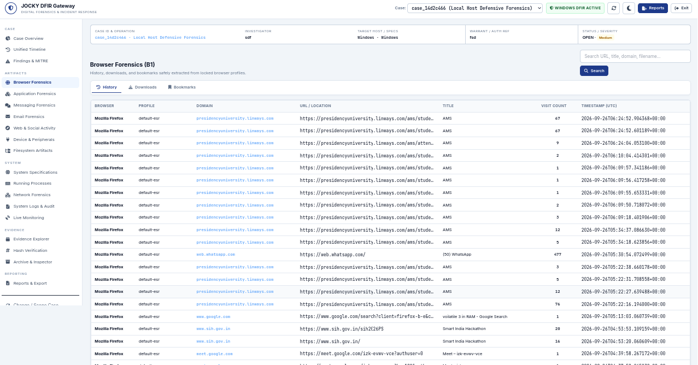

---

## B2 — Application Forensics

Application forensics presents installed software and execution-related artifacts where supported by the endpoint.

The interface exposes:

- Application name
- Publisher
- Version
- Installation/execution information
- Artifact source

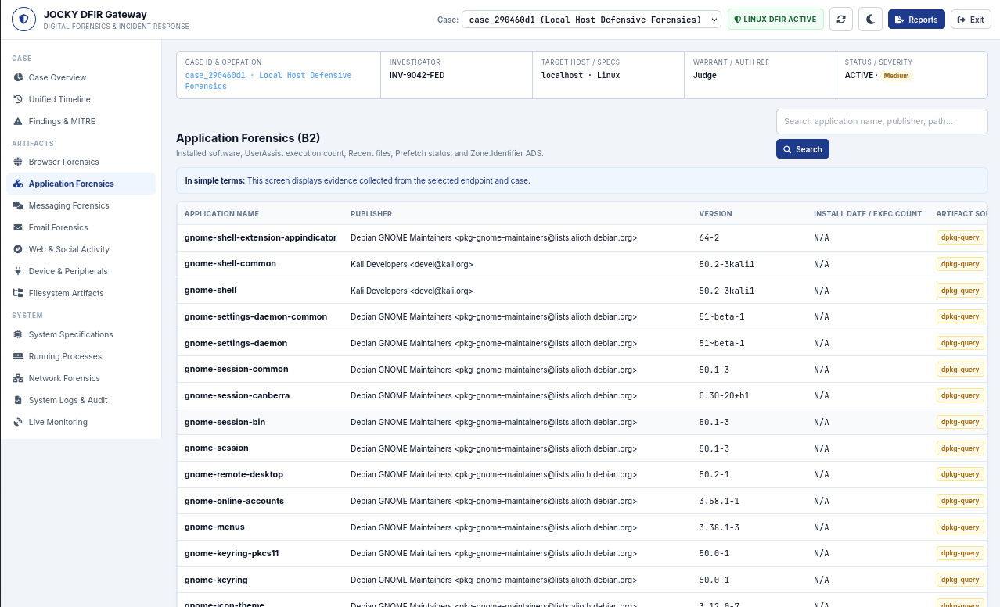

---

## B5 — Web & Social Platform Intelligence

Web activity is aggregated into recognizable platforms/domains with:

- Platform
- Domain
- Visit count
- Evidence type
- First/last observed timestamps
- Browser/profile provenance

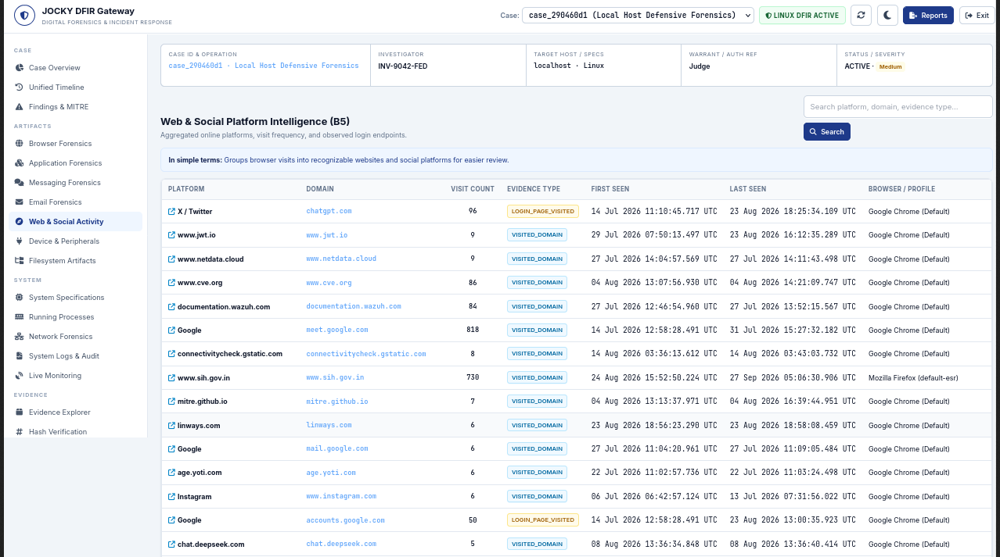

---

## B6 — Device & Hardware Forensics

The device module provides collected information about:

- USB/removable media
- Network adapters
- Bluetooth/peripherals where available
- Storage-related devices
- Hardware/raw references

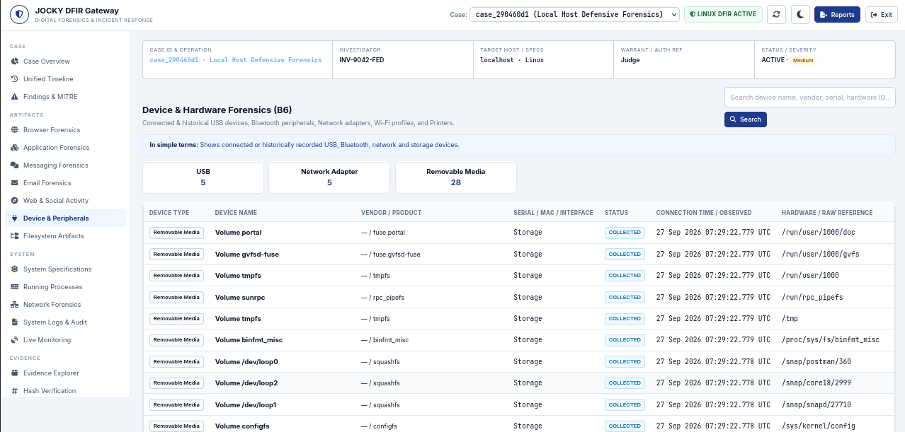

---

## B7 — System & Hardware Specifications

The system specification view summarizes:

- Hostname
- Operating system
- Kernel/build
- Architecture
- CPU
- Physical/logical cores
- RAM
- Boot time
- Uptime
- Other collected hardware metadata

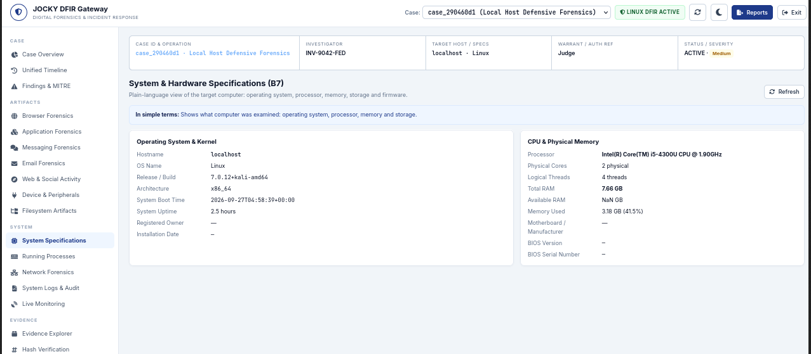

---

## Running Processes

The process view is designed as a dense investigator-oriented process table.

Displayed fields include:

- PID / PPID
- User
- State
- CPU and memory usage
- RSS / virtual memory
- Threads
- Start time
- Command
- Executable
- SHA-256 where available

Rows can be searched and investigated for additional process context.

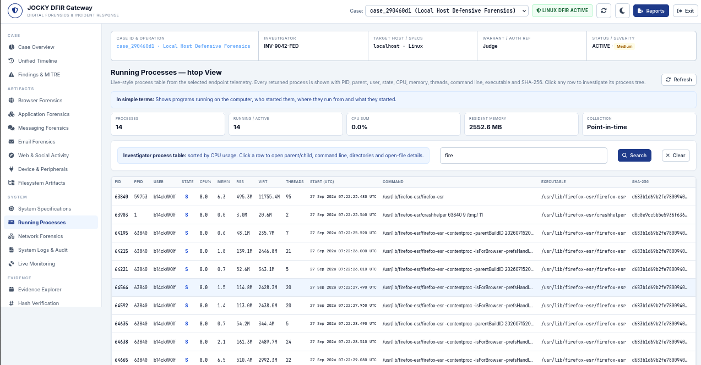

---

## Filesystem Forensics

The filesystem explorer supports controlled navigation of the target filesystem.

Features include:

- Root and directory navigation
- Back / Up navigation
- File metadata
- Permissions/mode
- Modified/access/change timestamps where available
- SHA-256
- File inspection
- Read-only preview
- Archive inspection

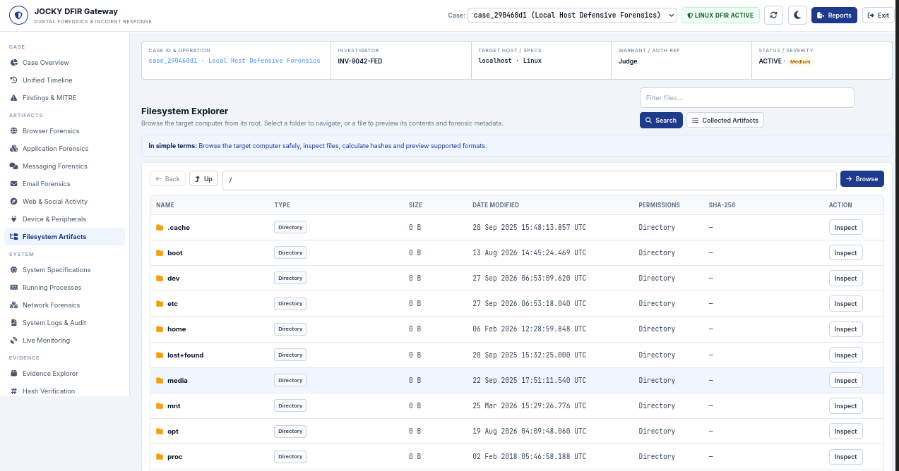

### File preview and forensic metadata

Supported previews can display the actual file content when the format is renderable, together with forensic metadata and hashes.

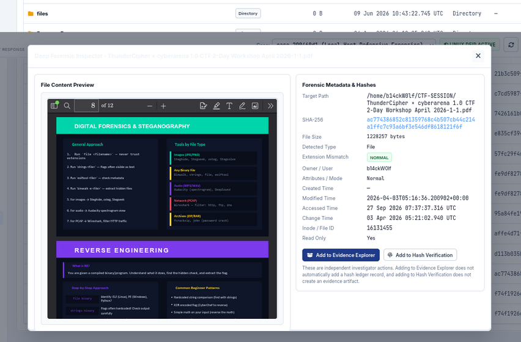

### Hex inspection

Binary data can be inspected through a hexadecimal representation.

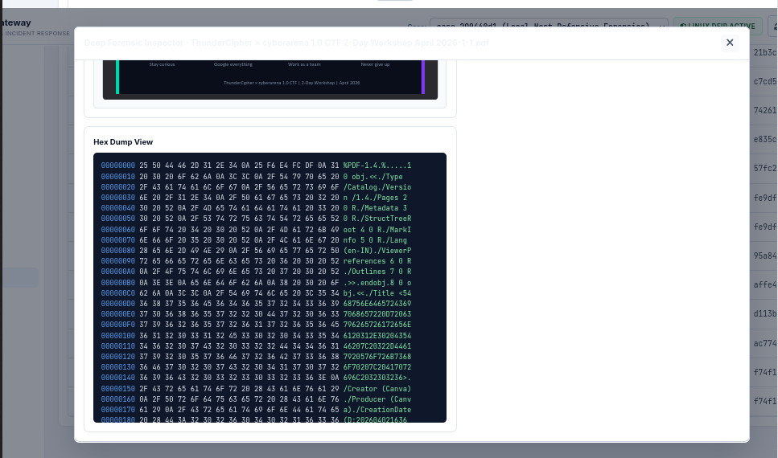

### Archive inspection

Archive contents can be inspected without treating the archive as a normal executable.

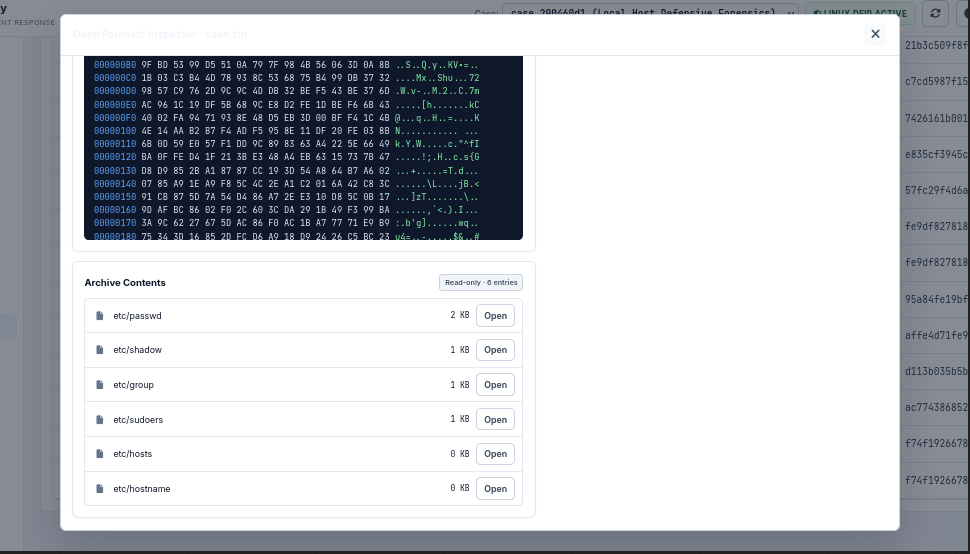

---

## System Logs & Audit

The log interface provides endpoint log records and investigator audit information.

The dashboard preserves:

- UTC timestamps
- Source/provider
- Severity/action
- Event/object
- Readable event text
- Detailed evidence view

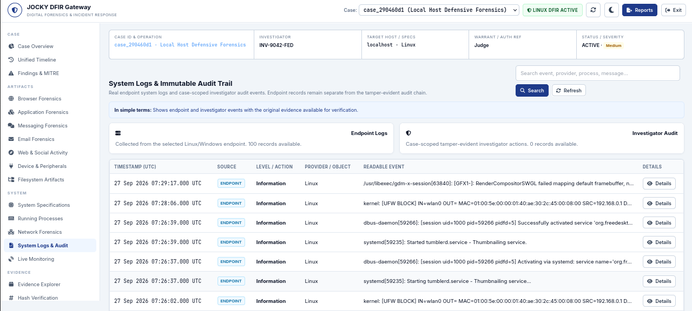

---

## Live Forensic Monitoring

The live monitoring engine provides investigator-controlled monitoring of endpoint changes.

The dashboard exposes:

- Engine status
- Buffered events
- Poll interval
- Case binding
- Recent monitoring deltas
- Process/network-related changes where collected

Monitoring can be started/stopped explicitly and an investigator can request an instant snapshot.

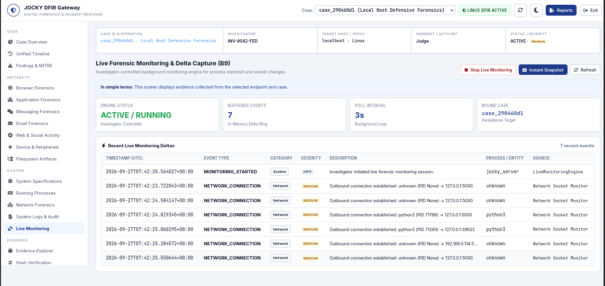

---

## Cryptographic Hash Verification

The hash ledger provides SHA-256 verification against case-associated evidence.

The workflow intentionally separates:

- **Add to Evidence Explorer**
- **Add to Hash Verification**

This prevents adding an item to one evidence workflow from silently modifying another.

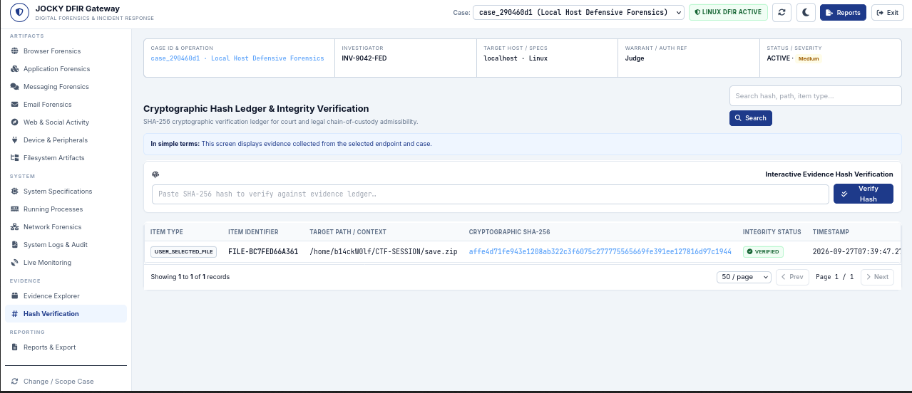

---

## Case Overview

The case overview aggregates the collection state and summarizes available evidence across the forensic modules.

The dashboard distinguishes between:

- Data successfully collected
- No evidence found
- Modules that have not generated evidence

This avoids representing missing telemetry as fabricated evidence.

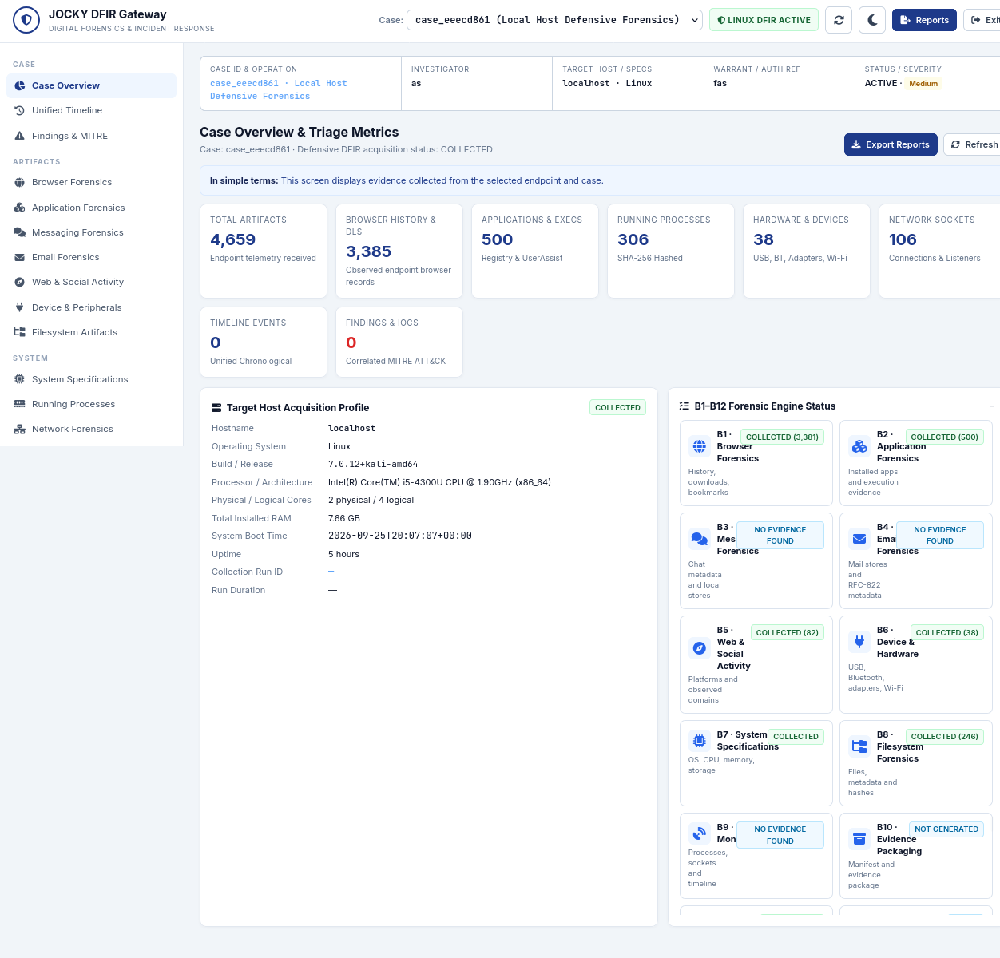

---

## Case Intake & Authentication

The gateway provides an investigator authentication step followed by case intake/scoping.

Case metadata can include:

- Case tracking ID
- Investigator/badge
- Start date/time
- Authorizing person/warrant reference
- Client/organization
- Evidence custodian
- Case status
- Severity
- Operation/case name
- Case scope

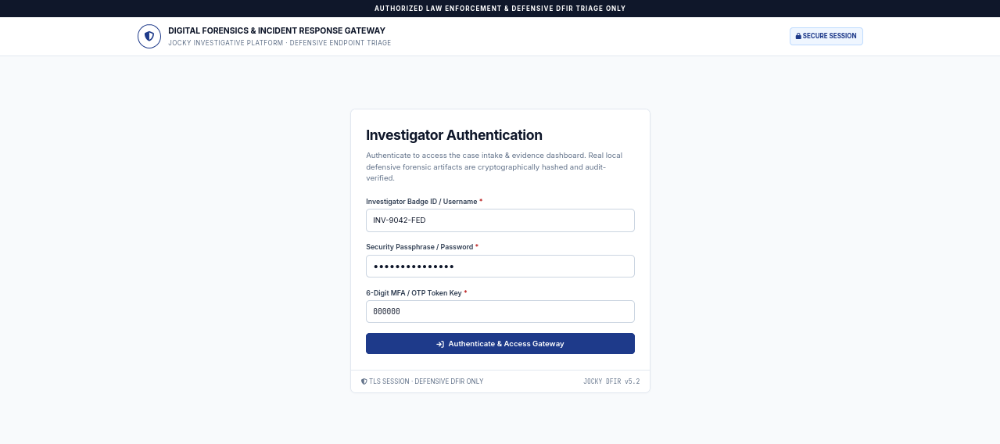

---

# Supported Platforms

| Platform | Role | Status |
|---|---|---|
| Linux | Gateway / endpoint collection | Supported |
| Windows | Gateway / endpoint collection | Supported |
| macOS | Not currently documented as a supported endpoint target | Not specified |

The project is designed around platform-specific collectors rather than assuming that Linux and Windows expose identical forensic artifacts.

---

# Project Structure

The repository is organized around the gateway, endpoint collection, forensic modules, tests, deployment, and documentation.

A representative structure is:

```text
JOCKY_DFIR/
├── agent/                  # Endpoint agent
├── collector/              # Endpoint forensic collectors
├── server/                 # Gateway, APIs, dashboard and reports
├── security/               # Evidence/security helpers
├── tests/                  # Automated test suite
├── deploy/                 # Deployment/build configuration
├── docs/                   # Documentation
├── scripts/                # Start/run helpers
├── examples/               # Example forensic inputs where present
├── .env.example            # Configuration template
├── requirements.txt        # Python dependencies
└── README.md
```

The exact contents can vary between releases.

---

# Installation

## Prerequisites

### Linux

Recommended environment:

- Python 3.11+
- Git
- `pip`
- Linux permissions appropriate for the collectors being used
- Optional forensic utilities where a collector explicitly requires them

Example:

```bash
python3 --version
git --version
```

### Windows

Recommended environment:

- Windows 10/11
- Python 3.11+
- Git for Windows
- PowerShell
- Administrator privileges for collectors that require elevated OS access

Example:

```powershell
python --version
git --version
```

---

# Clone the Repository

```bash
git clone https://github.com/Pratham-16/Z3r0_T34c3_01.git
cd Z3r0_T34c3_01
```

---

# Python Environment

## Linux

```bash
python3 -m venv .venv
source .venv/bin/activate
python -m pip install --upgrade pip
pip install -r requirements.txt
```

## Windows PowerShell

```powershell
py -3 -m venv .venv
.\.venv\Scripts\Activate.ps1
python -m pip install --upgrade pip
pip install -r requirements.txt
```

If PowerShell blocks activation for the current session:

```powershell
Set-ExecutionPolicy -Scope Process -ExecutionPolicy Bypass
.\.venv\Scripts\Activate.ps1
```

---

# Configuration

Create the local environment file from the supplied template:

## Linux

```bash
cp .env.example .env
```

## Windows PowerShell

```powershell
Copy-Item .env.example .env
```

Configure the gateway values in `.env`.

Example structure:

```dotenv
JOCKY_HOST=0.0.0.0
JOCKY_PORT=5000

JOCKY_DASHBOARD_USERNAME=<investigator-username>
JOCKY_DASHBOARD_PASSWORD=<strong-password>
JOCKY_DASHBOARD_OTP=<6-digit-otp>

JOCKY_API_KEY=<change-this-secret>
JOCKY_SECRET=<change-this-secret>
```

### Important

Do **not** commit `.env` to Git.

Use `.env.example` for shareable configuration templates and keep operational credentials/secrets local.

---

# Running on Linux

## Option A — project launcher

If the repository contains the Linux launcher:

```bash
chmod +x run_server.sh
./run_server.sh
```

or, if the launcher is located under `scripts/`, use the corresponding script in that directory.

## Option B — Python module

From the repository root:

```bash
python -m server.server
```

The gateway is expected to bind to the configured host/port, for example:

```text
http://127.0.0.1:5000
```

For a remote investigator workstation, bind/listen on the required interface and protect the deployment with the appropriate network controls.

---

# Running on Windows

Activate the virtual environment:

```powershell
.\.venv\Scripts\Activate.ps1
```

Then start the gateway using the Windows launcher supplied with the repository, if present.

For a direct Python start:

```powershell
python -m server.server
```

The dashboard will normally be available at:

```text
http://127.0.0.1:5000
```

### Windows collection notes

Some Windows forensic collectors require elevated privileges. Run the gateway/agent from an appropriately authorized administrative PowerShell session when a collector requires it.

---

# Running the Endpoint Agent

JOCKY uses an endpoint agent/collector model so that endpoint evidence is collected on the target operating system and delivered to the gateway.

Conceptually:

```text
Target Endpoint
      │
      │ agent registration / telemetry
      ▼
JOCKY Gateway
      │
      ▼
Selected Case
      │
      ▼
Investigator Dashboard
```

The exact agent start command can vary by build. Check the repository's agent/deployment documentation and generated build artifacts for the platform-specific launcher.

Typical development workflow:

```text
Linux:
    activate venv
    install dependencies
    configure gateway
    start gateway
    start Linux agent

Windows:
    activate venv
    install dependencies
    configure gateway
    start gateway
    start Windows agent
```

---

# Investigator Workflow

A typical investigation follows this sequence:

```text
1. Authenticate
       ↓
2. Create/Open Case
       ↓
3. Define Case Scope
       ↓
4. Connect/Detect Endpoint
       ↓
5. Collect Endpoint Telemetry
       ↓
6. Review Case Overview
       ↓
7. Investigate B1–B9 Artifacts
       ↓
8. Inspect Files / Archives
       ↓
9. Verify SHA-256 Evidence
       ↓
10. Correlate Findings / Timeline
       ↓
11. Generate Reports
```

---

# Evidence and Integrity Model

JOCKY treats evidence handling as a case-scoped workflow.

### Evidence lifecycle

```text
Endpoint Artifact
       ↓
Collection
       ↓
Normalization
       ↓
Case Association
       ↓
Metadata + Provenance
       ↓
SHA-256 Fingerprint
       ↓
Evidence Explorer
       ↓
Hash Verification
       ↓
Report / Export
```

### Hash verification

For a selected file:

```text
File
 │
 ├── Path
 ├── Size
 ├── Metadata
 └── SHA-256
          │
          ▼
   Evidence Ledger
          │
          ▼
   Verification Result
```

The dashboard can display the resulting integrity status for evidence records.

---

# Screenshots

## Dashboard


## Authentication


## Browser Forensics


## Application Forensics


## Running Processes


## System Specifications


## Device & Hardware


## Filesystem Explorer


## File Preview


## Hex View


## Archive Inspector


## System Logs


## Live Forensics


## Web & Social Activity


## Hash Verification


## Chain of Custody

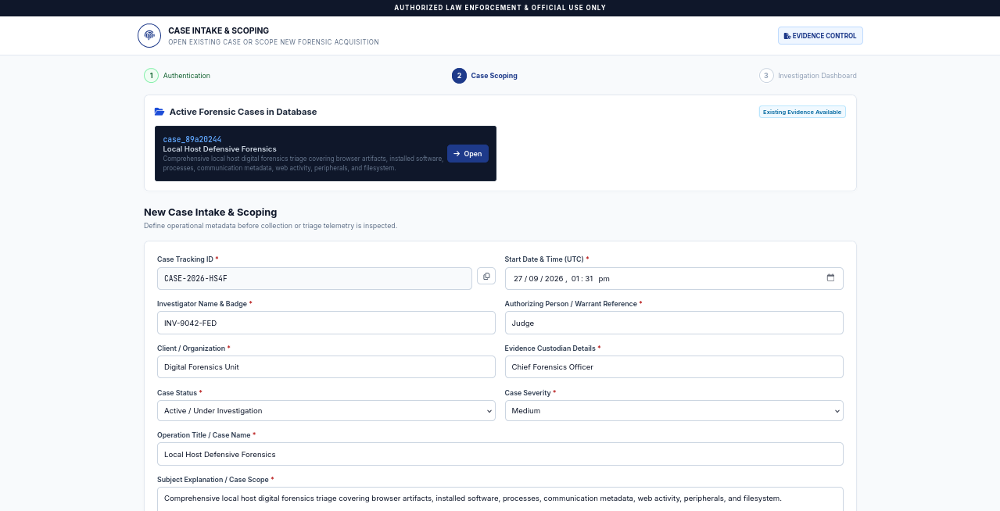

---

# Testing

Run the complete automated suite from the repository root:

```bash
python -m pytest -q
```

For the Windows-specific forensic regression tests:

```bash
python -m pytest tests/test_windows_forensics.py -v
```

The project should be considered ready for deployment only when the complete test suite and platform-specific regression tests pass in the intended environment.

---

# Troubleshooting

## Port 5000 is already in use

### Linux

```bash
ss -ltnp | grep :5000
```

or:

```bash
sudo lsof -i :5000
```

Stop the process using the port, or change:

```dotenv
JOCKY_PORT=5000
```

to another available port.

### Windows

```powershell
Get-NetTCPConnection -LocalPort 5000
```

---

## Python dependency problems

Confirm that the virtual environment is active:

### Linux

```bash
which python
python --version
```

### Windows

```powershell
Get-Command python
python --version
```

Then reinstall dependencies:

```bash
python -m pip install --upgrade pip
pip install -r requirements.txt
```

---

## No endpoint telemetry

If the dashboard reports that no endpoint telemetry has been received:

1. Confirm the endpoint agent is running.
2. Confirm the gateway host/port.
3. Confirm the endpoint can reach the gateway.
4. Confirm the configured API/authentication values.
5. Check gateway logs.
6. Refresh the relevant dashboard view manually.

The dashboard should show the absence of evidence rather than fabricate endpoint records.

---

## Browser artifacts are missing

Browser evidence depends on the target endpoint, installed browser, profile availability, permissions, and artifact state.

Verify:

- The relevant browser is installed.
- The endpoint agent can access the browser profile.
- The correct endpoint/case is selected.
- The browser was not excluded by permissions or collection scope.

---

# Security Notes

JOCKY is intended for **authorized defensive DFIR and incident-response operations**.

Use it only on systems and evidence for which the investigator has appropriate authorization.

Operational deployments should additionally use:

- Strong secrets
- TLS
- Network segmentation/firewall rules
- Restricted investigator accounts
- Protected `.env` files
- Appropriate endpoint privileges
- Secure evidence storage
- Access logging
- Backup and retention controls

Never commit production passwords, API keys, OTP secrets, encryption secrets, private certificates, or collected evidence databases to Git.

---

# Current Test Status

The current development snapshot was regression-tested with:

```text
278 passed
1 skipped
0 failed
```

A small number of non-failing Python/deprecation warnings may be emitted depending on the interpreter version.

---

## CI/CD & Cross-Platform Quality Gate

JOCKY includes a GitHub Actions CI pipeline that validates the project across multiple Python/runtime environments and operating systems before the release quality gate completes.

The demonstrated pipeline includes:

- Ubuntu / Linux test matrix
- Python 3.11
- Python 3.12
- Python 3.13
- Windows / Python 3.13
- Final **Release Quality Gate**

This helps detect platform-specific regressions before changes are accepted into the repository.

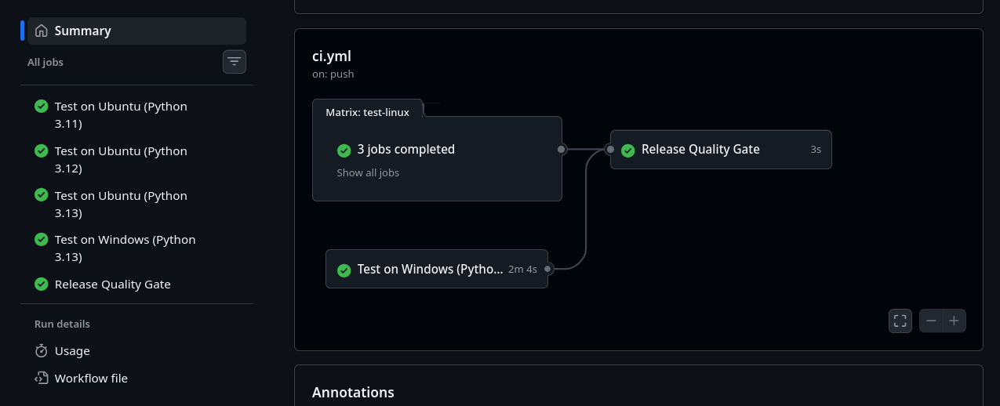

The pipeline is triggered on repository pushes and provides a reproducible automated validation layer for the cross-platform DFIR codebase.

---

# Repository

**GitHub:**  
https://github.com/Pratham-16/Z3r0_T34c3_01

---

## Project Identity

**JOCKY DFIR Gateway**  
Digital Forensics & Incident Response Gateway

**Focus:** Cross-platform endpoint triage, forensic artifact collection, evidence inspection, integrity verification, and investigator-controlled incident response.
