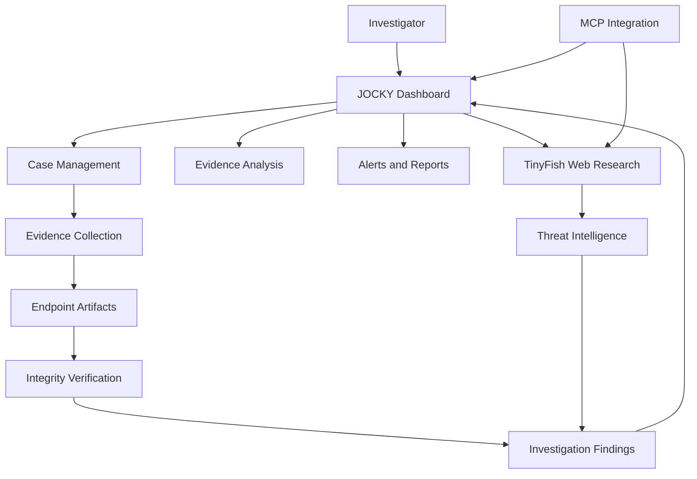

# JOCKY — DFIR Gateway

**An AI-assisted Digital Forensics and Incident Response platform powered by TinyFish.**

JOCKY is a digital forensics platform designed to help security investigators collect, examine, correlate, and report digital evidence through a centralized investigation dashboard. By combining endpoint evidence acquisition with web-based threat intelligence, JOCKY aims to make incident investigations more organized, traceable, and actionable.

Developed for **Swim with TinyFish — Presidency University Hackathon**.

---

## Overview

Digital investigations often involve evidence scattered across multiple sources, including browser activity, system logs, running processes, connected devices, and network events. Investigators need a structured way to examine these sources and connect their findings.

JOCKY brings these investigation workflows together in one platform, with a focus on evidence integrity, investigation visibility, and threat-intelligence enrichment.

## Key Capabilities

- **Centralized Investigation Dashboard** — Organize cases, review collected evidence, track alerts, and manage investigation workflows.
- **Endpoint Evidence Acquisition** — Support investigation workflows involving system activity, browser artifacts, processes, devices, and network information.
- **Threat Intelligence with TinyFish** — Use web research to gather relevant threat information and enrich investigations with external context.
- **Evidence Integrity** — Use SHA-256 hashing to help verify evidence integrity and identify changes to collected files.
- **Investigation Reports** — Structure findings into reports that support review, documentation, and incident response.
- **MCP Integration** — Provide an integration path for connecting compatible AI tools with investigation and threat-intelligence workflows.

## Architecture

The architecture illustrates the intended investigation workflow and integration points. The exact capabilities available depend on the configured collectors, services, and integrations.

## Technology Stack

| Component | Technology |
|---|---|
| Threat intelligence and web research | TinyFish |
| AI tool integration | Model Context Protocol (MCP) |
| Backend and application services | Python |
| Data persistence | SQLite / database layer |
| Interface | Web-based investigation dashboard |
| Evidence integrity | SHA-256 |
| Testing | Pytest |
| Version control | Git and GitHub |

## Investigation Workflow

1. **Create a case** — Establish an investigation workspace.
2. **Collect evidence** — Acquire supported endpoint artifacts and relevant system information.
3. **Verify integrity** — Calculate and record cryptographic hashes where supported.
4. **Enrich findings** — Gather relevant external threat intelligence using TinyFish.
5. **Review and correlate** — Examine evidence alongside the available contextual information.
6. **Generate reports** — Document findings for investigation and incident-response review.

## Why JOCKY?

JOCKY brings digital forensics workflows and web-based threat intelligence into a unified investigation experience. Its goal is to reduce fragmented analysis, improve evidence traceability, and help investigators move from raw artifacts toward documented findings.

## Security and Responsible Use

JOCKY is intended for authorized digital forensics, defensive security, and incident-response activities.

- Investigate only systems and data you are authorized to access.
- Protect API credentials and sensitive investigation data.
- Preserve evidence integrity and document acquisition methods.
- Validate external intelligence before treating it as a confirmed finding.
- Follow applicable privacy, evidence-handling, and legal requirements.

## Hackathon

**Event:** Swim with TinyFish  
**Institution:** Presidency University  
**Project:** JOCKY — DFIR Gateway

Built to explore how web-based AI agents and threat intelligence can enhance digital forensics and incident response.

## Author

**Mohith R**

GitHub: [View my GitHub profile](https://github.com/)

---

*JOCKY — Bringing evidence, intelligence, and investigation workflows together.*
