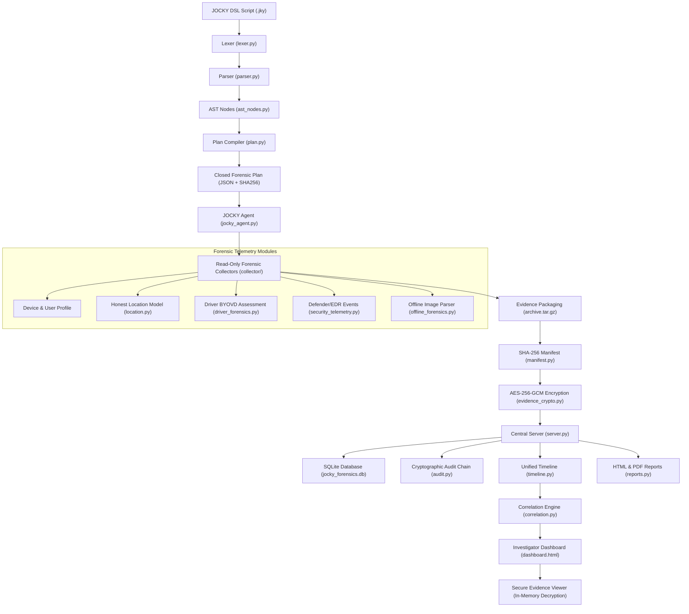
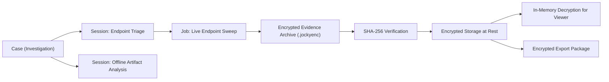

# JOCKY Architecture & Security Design — Stage 17/18 DFIR Platform

JOCKY is an authorized, closed, allowlisted Digital Forensics & Incident Response (DFIR) collection and investigation platform.

## System Architecture

## Case Architecture & Evidence Flow

## Security Boundaries & Forensics Principles

1. **No Security-Control Bypass**: JOCKY does not disable Windows Defender, EDRs, or security logging. Detections are recorded and preserved as evidence.
2. **Read-Only Telemetry**: Enforces read-only collection. No process injection, credential harvesting, LSASS dumping, or kernel driver subversion.
3. **Honest Location Model**: Tiered location model explicitly declaring accuracy, confidence, and disclosure warnings (`EXACT LOCATION: UNAVAILABLE` when GPS is missing).
4. **Driver BYOVD Assessment**: Analyzes digital signatures, publisher metadata, SHA-256 hashes, and known vulnerable driver databases without executing or exploiting drivers.
5. **Chain of Custody**: Cryptographic audit chaining of all investigator actions (`CASE_CREATED`, `COLLECTED`, `HASHED`, `ENCRYPTED`, `VIEWED`, `VERIFIED`, `EXPORTED`).
